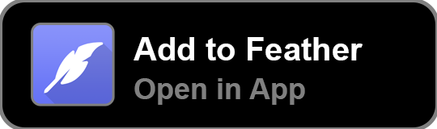

> [!IMPORTANT]
> **This is an unofficial bugfixing fork of [arichornlover/uYouEnhanced](https://github.com/arichornlover/uYouEnhanced).** It tries to fix bugs in uYouEnhanced, starting with casting to a TV. It is not affiliated with the upstream project, everything not listed under [What this fork changes](#what-this-fork-changes) is upstream's work, and fixes here are best effort.

## Bugs this fork is trying to fix

| Bug | Status |
| --- | --- |
| Casting to a TV or Chromecast says "Local Network access is required" even though the permission is on | **Fix attempted, not confirmed on a device yet.** For YouTube **21.x** Fix Casting now also carries two hooks found by reading the 21.38.2 binary (details in the casting FAQ below). YouTube **20.10.4** and older use the flag-based fix from [YTweaks](https://github.com/fosterbarnes/YTweaks#supported-youtube-versions) instead. |
| A cast works for about 10–20 seconds, then the cast icon changes and the TV starts playing the video, with ads, from its own YouTube app | **Fix attempted, not confirmed on a device yet.** The suspected cause is YouTube 21.x handing the cast over from the Chromecast connection to the TV's own YouTube app. The new *Keep Casting on the Cast Connection* switch tries to stop that, and *Casting Diagnostics* records what happens so the real cause can be found if it still switches (see the casting FAQ below). |
| The TV goes black, shows its boot screen and restarts about 30 seconds into a cast | **Open, cause not known.** The debug report from one such cast shows the TV's Cast service stopped answering the phone a few seconds before the phone ended the cast, so the TV (or its YouTube app) most likely crashed first. That is not confirmed. The casting FAQ below lists tests that tell a TV problem from a problem in this app. |
| The app sometimes crashes | **Open, cause not known.** Every hook on a YouTube class was checked against the 21.38.2 binary and none points at a method YouTube no longer has, so it is not an obvious missing method. The debug log now survives a crash better (it is flushed when the app goes to the background and before an uncaught exception ends the app). If it keeps happening, send the crash log: *Settings > Privacy & Security > Analytics & Improvements > Analytics Data*, newest `YouTube-...` entry, and `Scripts/crash-analysis/` can read it. |
| The first launch after installing opens the browser | **Fix attempted, not confirmed on a device yet.** See *What this fork changes* below. |
| Scrolling and switching tabs stutters | **Fix attempted, not confirmed on a device yet.** See *What this fork changes* below. |
| Video previews in the feeds play with sound, and turning the sound off does not stick | **Fix attempted, not confirmed on a device yet.** The new *Mute Video Previews* switch (on by default) keeps them silent. See *What this fork changes* below. |
| Post pictures in the Home feed's community post shelves ("Communities you may like", "<channel>'s Community") are wider than the screen, with half of them cut off | **Fix attempted, not confirmed on a device yet.** *Fit Shelf Cards to the Screen* (on by default) keeps such cards within the screen (build 9), and now also scales the picture inside a card down to the card's width (in build 9 the card fitted but its picture kept its full size, so only a zoomed-in corner showed). Hiding the shelves instead is still possible (*Hide Community Post Shelves*, now off by default). |
| Now and then the video shows upside down in landscape, and turning the phone turns it upside down again | **Fix attempted, not confirmed on a device yet.** uYou's rotate button forced one landscape side and left the phone reporting the wrong orientation. *Fix the Rotate Button* (on by default) stops that. See *What this fork changes* below. |

## What this fork changes

- **Fix Casting is on by default again.** The default had been dropped from the code, so new installs started with it off.
- **App Version Spoofer is on by default.** On a fresh install of a YouTube build older than v20.50.10 (such as 20.10.4) the spoofer starts on and tells YouTube it is v20.50.10, which is meant to keep an old build from being refused as out of date. Only the version YouTube is told changes, not the app itself. A choice you have already made is never overwritten, and a build that is not older than v20.50.10 is left alone. If something misbehaves, turn **Enable App Version Spoofer** off in the uYouEnhanced settings to rule it out.
- **Casting fix for YouTube 21.x (experimental).** Two small hooks behind the Fix Casting switch, in `Sources/uYouPlusCastingFix.xm`. A re-signed app cannot send to multicast addresses, and YouTube 21.x uses one to check the Local Network permission and the Cast SDK uses its own multicast client to find Chromecasts, so casting is refused even with the permission on. The hooks make YouTube skip that check and make the Cast SDK find Chromecasts through the system's Bonjour instead. This was worked out from the 21.38.2 binary and has not been confirmed on a device yet, so please report how it goes.
- **Casting preflight.** The *Casting Preflight* workflow, and the summary of every build, lists which casting flags and which hook points of the 21.x fix a YouTube version still contains.
- **Keep casting on the Cast connection (experimental, on by default).** New switch *Keep Casting on the Cast Connection* on the uYouEnhanced settings page under *Miscellaneous*, in `Sources/uYouPlusCastingStayOnCast.xm`. YouTube 21.x can move a cast from the Chromecast connection over to the TV's own YouTube app (YouTube calls this *Media Hub*), which would explain a cast that ends after a few seconds and a TV that then plays ads on its own. The switch turns off four YouTube settings (three that steer casting toward the TV's own app, one that ends a cast when you start another video), stops swiping the player down from ending the cast, and ignores the Cast SDK's "device went away" reports while a cast is running. It only does anything while *Fix Casting* (YTweaks settings) is on. This comes from reading the 21.38.2 binary, not from watching it happen on a device, so it may not be the whole cause. Restart the app after changing it, and turn it off if casting gets worse.
- **Casting diagnostics (on by default).** New switch *Casting Diagnostics* in the same place, in `Sources/uYouPlusCastingDiagnostics.xm`. It records what happens to a cast, in order and with times (connect, hand-over, disconnect, changes of the cast button, whether the phone is on Wi-Fi), and turns on the Cast SDK's own log file. Both go into the report from *uYouEnhanced Debug Logs*, under *CAST DIAGNOSTICS* and *CAST SDK LOG*. It only watches, nothing is sent anywhere, and the Cast SDK log file is deleted when the app starts if it has grown past 3 MB. The report can contain the names and network addresses of devices on your Wi-Fi, so look it over before you share it, and turn the switch off once you no longer need it.
- **Ad blocker on by default.** The stronger *AdBlock Workaround* is switched on. The *Lite* variant and uYou's own *Remove YouTube ads* stay off, they overlap with it. This blocks ads inside this app. While casting, the video is played by the YouTube app on the TV, and any ads there come from that app, which this app cannot change.
- **Shorts, Create (+) and uYou tabs hidden by default.** These use uYou's own tab switches, and the same three switches are on the uYouEnhanced settings page under *UI Interface Options* (*Hide Shorts Tab*, *Hide Create Tab*, *Hide uYou tab*). Turn one off there and restart the app to get the tab back.
- **"YouTube featured" shelf hidden on the Home feed by default** ("Your home for ..." with an *Explore more* button). New switch *Hide YouTube Featured Shelf*, in `Sources/HideYouTubeFeatured.xm`. It matches the shelf by its text, which has not been checked against a real feed yet. If the shelf is still there, the debug log has lines starting with `HideFeatured` that show what to match.
- **SponsorBlock is included.** The build workflow's *Include iSponsorBlock* option is on by default, and iSponsorBlock is moved to its latest release (1.3.3), which fixes a crash on the player bars of newer YouTube versions. It is on out of the box (it skips *sponsor* segments).
- **SponsorBlock while casting (on by default, not confirmed on a device yet).** New switch *SponsorBlock While Casting* under *Miscellaneous* (listed when the build includes iSponsorBlock), in `Sources/uYouPlusCastingSponsorBlock.xm`. Reading the 21.38.2 binary shows that iSponsorBlock's skips already reach the TV: while casting, the phone keeps getting the TV's position four times a second, and a seek on the phone is passed on to the TV. Casting has three weak spots, and the switch deals with them. The TV only takes whole seconds, so a skip is rounded up to land just past the segment instead of in its last moment. YouTube drops a seek without a word when the TV has not loaded the video yet, and iSponsorBlock never tries again, so the TV's position is watched for a few seconds after each skip and the skip is sent again (twice at most) while the TV is still in the segment. And iSponsorBlock's channel whitelist looked at the last video played on the phone instead of the one on the TV. Every skip during a cast, and whether the TV took it, goes into the cast timeline of the debug report (*Casting Diagnostics*, lines starting with `sponsorblock:`). The skipping is done by the YouTube app on the phone, so it only works while the phone is still connected to the cast; whether it keeps working with the phone locked has not been tested. With the switch off, iSponsorBlock runs unchanged.
- **iSponsorBlock's button in the top bar hidden by default.** The *Hide iSponsorBlock button* switch is back under *UI Interface Options* and works again (`Sources/uYouPlusHideiSponsorBlockButton.xm`); upstream's version looked for the button in the wrong place and was later removed. iSponsorBlock's own settings (which segments to skip, the skip notice, the channel whitelist) open from the new *iSponsorBlock Settings* row right below it. The two buttons iSponsorBlock puts at the top of the video player are separate: turn off *Show iSponsorBlock Buttons in Video Player* in iSponsorBlock's settings to remove them.
- **Silent video previews (on by default, not confirmed on a device yet).** New switch *Mute Video Previews* under *Miscellaneous*, in `Sources/uYouPlusMutedFeedPreviews.xm`. YouTube 21.38.2 turns the sound of a feed preview back on in several ways besides the speaker button: pressing a volume button asks for sound, so can connecting headphones or a Bluetooth device, so can the per-video sound state that is synced between screens, and each new preview starts the way the last one ended. All of these go through one kind of status update, and the switch makes every one of them leave the preview muted except the one for opening the video, so the video itself still plays with sound. The speaker button and its "tap to unmute" hint are hidden; CC stays. It covers previews on Home, Subscriptions, Search and channel pages, Shorts previews in a feed and videos in posts.
- **Community post shelves can be hidden on the Home feed (off by default since the cards are now fitted, see below).** Switch *Hide Community Post Shelves* in the same place. It covers "Communities you may like" and the shelf of one channel's community ("<channel>'s Community"). The post cards of these shelves can come out wider than the screen, so half of the picture and the text are cut off: they sit in a sideways list that gives its items an unlimited width, and a card that sizes itself by its picture grows past the screen. They are laid out by YouTube's server and the app has no setting for their size, so the shelves are removed instead. They are matched by their titles (English), through the same filter as the "YouTube featured" shelf (`Sources/HideYouTubeFeatured.xm`); a single video whose title contains "'s Community" would be hidden too. If a shelf is still there, the debug log has `HideShelf candidate kept` lines that show what to match.
- **Cards of sideways shelves fitted to the screen (on by default, not confirmed on a device yet).** New switch *Fit Shelf Cards to the Screen*, in `Sources/uYouPlusFitShelfCards.xm`. In YouTube 21.38.2 the shelves that scroll sideways (Elements, `ELMCollectionNode`) leave the width of their cards open in all three places they size them, so a card that takes its width from its picture, like a community post with a wide picture, grows past the screen. Where the width is left open, the switch limits it to the width of the shelf minus 32 points, also while the shelf works out its height, so no gap is left. Cards that carry their own width are not changed. The picture of a post (`ELMImageNode`) is not limited by its card, though: when its CSS gives it no size, it takes the picture's own size (for a downloaded picture, about its size in pixels), however wide the card is. So while a card of such a shelf is laid out (`-[ELMCellNode willCalculateLayout:]` to `-didCalculateLayout:` with Yoga, `-calculateLayoutThatFits:restrictedToSize:relativeToParentSize:` without), a picture wider than the width it is offered (or, when it is offered no limit, the card's width minus 32 points) is scaled down to it with its proportions kept, and the card's height follows. Pictures that fit are not changed. The community post shelves are shown again by default.
- **uYou's rotate button no longer turns the video upside down (on by default, not confirmed on a device yet).** New switch *Fix the Rotate Button*, in `Sources/uYouPlusRotateButtonFix.xm`. uYou puts a rotate button (a circular arrow) into the player's controls by default. It forced the phone's reported orientation to one landscape side, whichever way the phone was held, and then to portrait; a phone held the other way showed the video upside down, and the next turn of the phone could flip it again. With the switch on, the button still opens fullscreen through YouTube's own toggle, but iOS picks the side the phone is held in and the phone keeps reporting its real orientation. Nothing else in this build forces an orientation (YouTube's own fullscreen button asks iOS for either landscape side).
- **These defaults (the casting and SponsorBlock switches included) are applied once**, on the first launch of a build that has them, and they replace what an older install had stored for those switches. An install that already had earlier defaults only gets the ones added since (the newest are *Fit Shelf Cards to the Screen* and *Fix the Rotate Button*, which also shows the community post shelves again), so what you changed in the meantime is kept. After that, whatever you set in the settings is kept (`Sources/uYouPlusForkDefaults.xm`).
- **AltStore / SideStore / Feather source.** Builds published from this fork can be installed with the buttons below.
- **AltStore, SideStore and Feather see every new build as an update.** AltStore only offers an update when the version in the source differs from the installed one, and every build of this fork has the same YouTube version. The build now adds its run number to the version the sideloader sees (YouTube 21.38.2, build 5 is `21.38.2.5`; the *What's New* text names the real YouTube version and the build). YouTube itself is given `21.38.2` back by the bundle hooks in `Sources/uYouPlusPatches.xm`, and `CFBundleVersion`, which YouTube reports as its own version, is not touched. The stamp is added by the *Stamp build number into the app version* step of the build workflow. The sideloader looks for updates when it refreshes its sources (pull down on its *Browse* tab if it has not noticed yet).
- **Smoother scrolling and tab switching (fix attempted, not confirmed on a device).** The ad filters, the Shorts-cells filter and the featured-shelf filter used to turn every item of a feed page into text, several times over, on the main thread; that conversion is slow and showed as a stutter when scrolling and when switching tabs. They now search the item's data directly and remember the answer per item (`Sources/UYTFeedText.h`). A view diagnostic that ran for every view on screen is gone, and the debug log is now written in the background in batches, so writing it can no longer hold the app up.
- **The first launch after an install or update no longer jumps to the browser (fix attempted, not confirmed on a device).** The likely cause is the *Open* button of the sideloader, which starts the app with a link of its own (`altstore-...://`) that YouTube hands to the system as an outside link. Those links are now ignored, and for the first 20 seconds of the first launch of a build the app does not pass web links on to the browser. A link you tap in that time does nothing, and the debug log says what was held back (lines starting with `LaunchGuard`, scheme and host only). The code is in `Sources/uYouPlusLaunchGuard.xm`.
- **Casting FAQ** rewritten with the current status and the known workarounds.

## Install this fork

&nbsp;

&nbsp;

&nbsp;

These builds are not signed for your device: AltStore and SideStore sign them with your Apple ID as they install them (with a free Apple ID the app has to be refreshed every 7 days), and Feather signs them with the certificate you imported. If a button says the source can't be loaded, no build has been published from this fork yet.

## Lightweight Alternative - YouMod

    
Read more
 

# Looking for a Lighter Option? Check Out YouMod

[YouMod](https://github.com/Tonwalter888/YouMod) is a lightweight, open-source alternative that aims to recreate the most popular [YTLite](https://github.com/dayanch96/YTLite) features after YTLite became paid. If you prefer a simpler, single-tweak approach over uYouEnhanced's all-in-one bundle, YouMod may be worth considering.

### YouMod — Pros

- **Fully open source** (GPLv3) — unlike uYou 3.0.4 (closed source), YouMod's entire codebase makes more sense for doing PRs and etc.
- **Lightweight architecture** — single tweak with fewer dependencies, less chance of tweak conflicts.
- **UI customization** — OLED theme, OLED keyboard, tab bar reordering, navigation bar and player element hiding.
- **Built-in & better downloading** — supports video and audio downloads with quality selection, much better than uYouEnhanced rigid downloading system.
- **Element hiding** — hide Shorts, posts, premium upsells, fullscreen action buttons, and more.
- **Modern feature set** — recreates many YTLite-era features (feed mods, player controls, Shorts customization). And features are more stable than uYouEnahanced!

### YouMod — Cons

- **No uYou integration** — lacks uYou's feaatures such as download manager, native PiP, and media playback engine, though I believe YouMod carries alternative features that are superior than this.
- **No version spoofing** — cannot spoof the YouTube app version to bypass update prompts and as a need to "fix" some features that break.
- **No exclusive features** — lacks LowContrastMode, NotificationsTab, YTAppVersionSpoofer, and other uYouEnhanced extras.
- **Some reported UI bugs** — open issues include problems with fullscreen action hiding, Shorts feed visibility, and time slider positioning on certain YouTube versions.

> **TL;DR:** YouMod is a great choice if you want a lightweight, open-source tweak focused on UI customization and basic downloading. If you need advanced download reliability, SponsorBlock, PiP, dislike counts, or comprehensive YouTube-bug fixes, uYouEnhanced remains as a different feature-complete option.

<h1 align="center">
  <strong>uYouEnhanced</strong>
</h1>

  

  

  

    
    
    

    <a href="https://github.com/arichornlover/uYouEnhanced/stargazers"></img></a>

> [!NOTE]
> uYouEnhanced is a **modified version** of uYou. **Please DO NOT bother MiRO92 with issues unrelated to uYou!**

# Table of Contents

   
   
   
   
   
   
   
   
  

# Credits

<table id='credit'>
<tr>

<MiRO92>
<td align="center">

 

</td>

<qnblackcat>
<td align="center">

 

</td>

<PoomSmart>
<td align="center">

 

</td>

<level3tjg>
<td align="center">

 

</td>

<BandarHL>
<td align="center">

 

</td>

<Galactic-Dev>
<td align="center">

 

</td>
</tr>

<tr>

<julioverne>
<td align="center">

 

</td>

<hbang>
<td align="center">

 

</td>

<Lyvendia>
<td align="center">

 

</td>

<therealFoxster>
<td align="center">

 

</td>

<ichitaso>
<td align="center">

 

</td>

<AhmedBafkir>
<td align="center">

 

</td>
</tr>

<tr>

<CokePokes>
<td align="center">

 

</td>

<ISnackable>
<td align="center">

 

</td>

<dayanch96>
<td align="center">

 

</td>

<ssuesskind>
<td align="center">

 

</td>

<balackburn>
<td align="center">

 

</td>

<dodieboy>
<td align="center">

 

</td>
</tr>

<tr>

<bhackel>
<td align="center">

 

</td>

<theos>
<td align="center">

 

</td>
</tr>
</table>

# Features

1. **uYou:** uYou has a ton of features that I can't list them all. Visit [here](https://miro92.com/repo/depictions/?p=com.miro.uyou) for more info!

2. **iSponsorBlock:** Skips annoying sponsor ads inside videos. iSponsorBlock is based on [SponsorBlock engine](https://sponsor.ajay.app/). Basically, this is the iOS version of the SponsorBlock extension.

3. **YouPiP:** enable YouTube's **native PiP**. More options are in YouTube Settings - General.

4. **YTUHD:** unlock VP9 codec and in effect, enables video quality of 2K and 4K. You can enable/disable YTUHD in YouTube Settings - Video quality preferences.

  
And many more...!

5. **YTClassicVideoQuality:** Since YouTube v16.xx, changing video quality requires an extra step. YTClassicVideoQuality brings back the old video quality selector, which is more user-friendly than the new one.

6. **YTNoHoverCards:** This tweak offers the option to enable or disable the annoying suggested videos that appear at the end of YouTube videos.

7. **YouRememberCaption:** YouRememberCaption makes YouTube remember your video caption setting (if not already).

8. **NoYTPremium:** NoYTPremium removes YouTube Premium upsells, preventing the ads and promotions for YouTube Premium from appearing.

9. **YTSpeed:** YTSpeed adds additional playback speed options of 2.25x, 2.5x, 2.75x, 3x and more to the YouTube app, providing more flexibility in video playback speed.

10. **YTMiniplayerEnabler:** YTMiniplayerEnabler enables the Miniplayer feature for all YouTube videos.

11. **DontEatMyContent:** This tweak prevents the notch or Dynamic Island from obstructing 2:1 video content on YouTube, ensuring a better viewing experience.

12. **YTABConfig:** This tweak gives users control over YouTube's A/B testing flags, allowing them to enable or disable experimental features.

13. **YouMute:** YouMute provides a button to mute YouTube videos in the video player, offering a convenient way to toggle the audio on and off.

14. **YouQuality:** YouQuality provides a button to change the video quality of YouTube videos in the video player, allowing quick access to different quality options.

15. **YouTimeStamp:** YouTimeStamp provides a button to copy the video url with the timestamp of whatever part of the video you are currently on.

16. **YTVideoOverlay:** YTVideoOverlay adds buttons to overlay the video, providing quick access to features like captions, speed control, and quality settings.

17. **NotificationsTab:** This tweak recreates the Notifications Tab that was removed from the YouTube App back in 2020, also the tweak includes customization for the tab if you are feeling nostalgic.

18. **YTAppVersionSpoofer:** This tweak allows users to spoof the version of the YouTube app they are using, this is designed to spoof to older YouTube App versions. This can be useful for bypassing certain version checks or retaining features that may have been removed/disabled in newer updates. **<-- uYouEnhanced Exclusive Feature (subject to change)**

19. **LowContrastMode:** LowContrastMode is a tweak that allows users to darken the text in the YouTube app, making it easier to read. **<-- uYouEnhanced Exclusive Feature (subject to change)**

# Known issues

- **uYou**: Issues related to uYou are listed [here](https://github.com/MiRO92/uYou-for-YouTube/issues). Because uYou is not being updated frequently, we recommended creating bug reports on this repo.

- Issues related to **uYouEnhanced** can be found [here](https://github.com/arichornlover/uYouEnhanced/issues/).

# Frequently asked questions

**Q: Casting to a TV/Chromecast stopped working.**
Sideloaded builds often say "Local Network access is required" when casting, or find no devices, even though the permission is on in iOS Settings. What YouTube 21.38.2's code does (read from the binary): the app is re-signed with your own certificate, which cannot carry the multicast entitlement, yet YouTube checks the permission by sending a packet to a multicast address, and the Cast SDK looks for Chromecasts the same way. Both sends fail, so YouTube concludes the permission is denied.
- **On YouTube 21.x:** keep **Fix Casting** on (the default) and restart the app after changing it. It now switches both multicast uses off. This is experimental and has not been confirmed on a device yet. iOS asks for Local Network access the first time YouTube looks for devices, so tap Allow; if you said no earlier, turn on Local Network for YouTube in iOS Settings.
- If it still fails, try to cast, then open **uYouEnhanced Debug Logs** in the settings, export the report and share it. Lines that start with `[uYouPlus] CastingFix` show whether the fix ran.
- **On YouTube 20.10.4 or older**, Fix Casting works through A/B flags instead ([YTweaks README](https://github.com/fosterbarnes/YTweaks#supported-youtube-versions); the [YouTube Plus FAQ](https://teletype.in/@dvntm/ytplus_faq) says 20.14.1).
- TVs that can only be found through SSDP (older TVs without Chromecast built in) stay undiscoverable on a sideloaded build for the same reason. Pair those with the TV code, or use AirPlay if the TV supports it.
- Run the **Casting Preflight** workflow (Actions tab) with your IPA URL to see which casting flags and fix hook points that YouTube version contains. Every build adds the same report to its run summary.

**Q: Casting starts, then after about 10–20 seconds it switches over to the TV's own YouTube app and plays ads.**
The cast icon changes and the TV carries on from its own YouTube app instead of the video you cast. Any ads there come from the TV's app, which this app cannot block. YouTube 21.x has a feature (*Media Hub*) that can swap the Chromecast connection for a link to the TV's own app, and that is the suspected cause. It has not been confirmed on a device.
- Keep **Keep Casting on the Cast Connection** on (the default, uYouEnhanced settings → *Miscellaneous*) and restart the app after changing it. It blocks that swap and needs **Fix Casting** to be on as well.
- The same switch also stops YouTube 21.x from ending the cast when you swipe the player down or start another video on the phone (both are part of the *Media Hub*; a debug report from a real cast showed it ending that way). After a swipe the player should shrink to the mini player and the cast keep running, as it did before YouTube added this. Not confirmed on a device yet.
- If it still switches, leave **Casting Diagnostics** on, cast until it happens, then open **uYouEnhanced Debug Logs**, export the report and share it. The *CAST DIAGNOSTICS* timeline and the *CAST SDK LOG* section show what ended the cast. They can contain names and addresses of devices on your network, so look the report over first. Please also say whether the TV's own YouTube app is signed in, and whether the account has YouTube Premium.
- If the switch makes casting worse, turn it off. It only changes casting, nothing else in the app.

**Q: The TV goes black, shows its boot screen and restarts a few seconds into a cast.**
In the one debug report from this, the Cast heartbeat to the TV went unanswered for several seconds before the phone ended the cast, which points at the TV (or its YouTube app) crashing first. It has not been confirmed. These tests tell the two cases apart:
- Play the same video in the TV's own YouTube app, with no phone involved. If the TV restarts then too, it is the TV.
- Cast the same video from another device, for example YouTube in Chrome on a PC. If that restarts the TV as well, the TV's Cast receiver is the problem, not this app.
- Check the TV for a software update, then unplug it for a minute.
- If none of that restarts the TV but casting from this app still does, export the debug report right after it happens and share it.

**Q: YouTube shows an "Update required" / "Please update" screen.**
Enable **Enable App Version Spoofer** in uYouEnhanced's settings, pick a newer YouTube version from **Version spoofer selector**, and restart the app. In this fork the spoofer is already on and set to v20.50.10 for builds older than that, so if the screen still appears, YouTube is rejecting v20.50.10 too: pick a newer version in the selector.

**Q: The app crashes on launch or misbehaves after an update.**
Make sure you are on the [latest release](https://github.com/arichornlover/uYouEnhanced/releases/latest) and that your YouTube version matches the [version information](#download) table. Note that some **uYou** features do not work on newer YouTube versions (see the news note in the Download section).

**Q: Where should I file a bug report?**
On the [upstream issue tracker](https://github.com/arichornlover/uYouEnhanced/issues/) — including uYou-specific bugs. Please search the open issues first; many reports (sign-in, casting, update screen) are covered by the answers above.

## Download

- This fork's builds are installed with the AltStore / SideStore / Feather buttons in [Install this fork](#install-this-fork) at the top of this page. The links below belong to the upstream project.
- The latest version of **uYouEnhanced** can be found under [Releases](https://github.com/arichornlover/uYouEnhanced/releases/latest).
- **Compatibility:** Requires iOS/iPadOS 16.0 or later.
- For AltStore user: 

  - My official AltStore repo (uYouEnhanced - **iOS 16+**): https://therealfoxster.github.io/altsource-viewer/view/?source=https://raw.githubusercontent.com/arichornlover/arichornlover.github.io/main/apps.json

  - [Open in AltStore (v21.20.4-3.0.5)](https://tinyurl.com/4v8fju3s) - It will take a while to install because AltStore needs to download the IPA first.
  - NEWS - Nov 27 2024-Aug 22 2026: Please be aware that some of the **uYou** features aren't working in newer versions of YouTube.

  
Version information (last updated: October 9, 2026)

| **Tweaks/App** | **Developer** | **Version** | **Open source** |
| - | - | :-: | :-:  |
| **YouTube** | Google Inc | 21.20.4 | ✖︎ |
| [uYou](https://github.com/MiRO92/uYou-for-YouTube) | [MiRO92](https://twitter.com/miro92) | 3.0.5 (UNOFFICIAL) | ✖︎ |
| **OpenYoutubeAndShorts** | [CrossiDev-Studio](https://github.com/CrossiDev-Studio) | 1.0 | [✔︎](https://github.com/CrossiDev-Studio/OpenYoutubeAndShorts) |
| **iSponsorBlock** | [Galactic-Dev](https://github.com/Galactic-Dev) | 1.3.2 | [✔︎](https://github.com/Galactic-Dev/iSponsorBlock) |
| **YTNoHoverCards** | [level3tjg](https://twitter.com/level3tjg) | 0.0.3 | [✔︎](https://github.com/level3tjg/YTNoHoverCards) |
| **YTMiniplayerEnabler** | [level3tjg](https://twitter.com/level3tjg) | 0.0.3 | [✔︎](https://github.com/level3tjg/YTMiniplayerEnabler) |
| **DontEatMyContent** | [therealFoxster](https://github.com/therealFoxster) | 1.1.11 | [✔︎](https://github.com/therealFoxster/DontEatMyContent) |
| **YTSpeed** | [Lyvendia](https://github.com/Lyvendia) | 1.0.1 | [✔︎](https://github.com/Lyvendia/YTSpeed) |
| **Alderis Color Picker** | [HASHBANG Productions](https://github.com/hbang) | 1.2 | [✔︎](https://github.com/hbang/Alderis) |
| **YTUHD** | [PoomSmart](https://twitter.com/poomsmart) | 2.2.3 | [✔︎](https://github.com/PoomSmart/YTUHD) |
| **YouLoop** | [bhackel](https://github.com/bhackel) | 1.1.0 | [✔︎](https://github.com/bhackel/YouLoop) |
| **YouMute** | [PoomSmart](https://twitter.com/poomsmart) | 1.3.3 | [✔︎](https://github.com/PoomSmart/YouMute) |
| **YouPiP** | [PoomSmart](https://twitter.com/poomsmart) | 1.12.10 | [✔︎](https://github.com/PoomSmart/YouPiP) |
| **YouQuality** | [PoomSmart](https://twitter.com/poomsmart) | 1.3.6 | [✔︎](https://github.com/PoomSmart/YouQuality) |
| **YouSpeed** | [PoomSmart](https://twitter.com/poomsmart) | 1.6.2 | [✔︎](https://github.com/PoomSmart/YouSpeed) |
| **YouTimeStamp** | [arichornlover](https://github.com/arichornlover) | 1.1.0 | [✔︎](https://github.com/aricloverextra/YouTimeStamp) |
| **IAmYouTube** | [PoomSmart](https://twitter.com/poomsmart) | 1.3.1 | [✔︎](https://github.com/PoomSmart/IAmYouTube) |
| **YTABConfig** | [PoomSmart](https://twitter.com/poomsmart) | 1.9.1 | [✔︎](https://github.com/PoomSmart/YTABConfig) |
| **YTIcons** | [PoomSmart](https://twitter.com/poomsmart) | 1.1.0 | [✔︎](https://github.com/PoomSmart/YTIcons) |
| **NoYTPremium** | [PoomSmart](https://twitter.com/poomsmart) | 1.0.7 | [✔︎](https://github.com/PoomSmart/NoYTPremium) |
| **YTNoPaidPromo** | [PoomSmart](https://twitter.com/poomsmart) | 1.0.0 | [✔︎](https://github.com/PoomSmart/YTNoPaidPromo) |
| **YouRememberCaption** | [PoomSmart](https://twitter.com/poomsmart) | 1.0.0 | [✔︎](https://poomsmart.github.io/repo/depictions/youremembercaption.html) |
| **Return YouTube Dislike** | [PoomSmart](https://twitter.com/poomsmart) | 1.13.17 | [✔︎](https://github.com/PoomSmart/Return-YouTube-Dislikes) |
| **YouTube-X** | [PoomSmart](https://twitter.com/poomsmart) | 1.7.23 | [✔︎](https://github.com/PoomSmart/YouTube-X) |
| **YTVideoOverlay** | [PoomSmart](https://twitter.com/poomsmart) | 2.3.5 | [✔︎](https://github.com/PoomSmart/YTVideoOverlay) |
| **YouGroupSettings** | [PoomSmart](https://twitter.com/poomsmart) | 1.0.8 | [✔︎](https://github.com/PoomSmart/YouGroupSettings) |
| **YTHoldForSpeed** | [joshuaseltzer](https://github.com/joshuaseltzer) | 1.2.3 | [✔︎](https://github.com/joshuaseltzer/YTHoldForSpeed) |
| **YTweaks** | [fosterbarnes](https://github.com/fosterbarnes) | 0.6.9 | [✔︎](https://github.com/fosterbarnes/YTweaks) |
| **LowContrastMode** | [arichornlover](https://github.com/arichornlover) | 2.0.0 | [✔︎](https://github.com/arichornlover/YTLowContrastMode) |

# Building

See [arichornlover/Building - Wiki](https://github.com/arichornlover/uYouEnhanced/wiki/Building)
or [qnblackcat/Building - Wiki](https://github.com/qnblackcat/uYouPlus/wiki/Building).

# Installation

See [Installation - Wiki](https://github.com/qnblackcat/uYouPlus/wiki/Installation).

# Support the developers

&nbsp;

&nbsp;

&nbsp;

&nbsp;

&nbsp;

&nbsp;

# Wiki

See [arichornlover - Wiki](https://github.com/arichornlover/uYouEnhanced/wiki/) or [qnblackcat - Wiki](https://github.com/qnblackcat/uYouPlus/wiki/)

Scrolled all the way to the bottom?
Then it is a huge thank you to **qnblackcat**, **PoomSmart**, and all the other developers whose work that made this whole uYouEnhanced fork possible!
